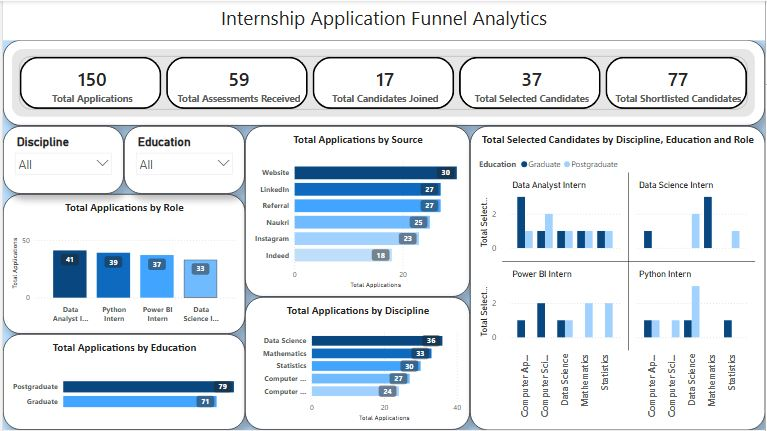

# Internship Application Funnel Analytics
## Project Overview

The Internship Application Funnel Analytics project analyses candidate applications across different stages of an internship recruitment process. It helps understand application trends, recruitment sources, candidate selection and joining outcomes.
The project uses a simulated dataset of 150 internship applications and presents the analysis through an interactive Power BI dashboard.

## Project Objectives
- Analyse internship applications across different recruitment stages.
- Identify the most effective application sources.
- Compare applications across internship roles and academic disciplines.
- Analyse candidates based on their education level.
- Track shortlisted, assessed, selected and joined candidates.

## Tools & Technologies
- Python
- Pandas
- MySQL
- SQL
- Power BI
- DAX

## Dataset Description
The dataset contains 150 records with the following columns:
| Column | Description |
|---|---|
| Application_ID | Unique application ID |
| Candidate_ID | Unique candidate ID |
| Education | Graduate or Postgraduate |
| Discipline | Candidate's academic discipline |
| Role | Internship role applied for |
| Source | Application source |
| Short_listed | Shortlisting status |
| Assessment | Assessment status |
| Interview | Interview status |
| Selection | Selection status |
| Offer | Offer status |
| Joining | Joining status |

**Note:** The dataset is simulated using Python for learning and analysis purposes.

## Key Performance Indicators (KPIs)

The dashboard includes the following KPIs:

- Total Applications: 150
- Total Assessments Received: 59
- Total Candidates Joined: 17
- Total Selected Candidates: 37
- Total Shortlisted Candidates: 77

## Dashboard Features

### 1. Applications by Source
Analyses the number of applications received through LinkedIn, Referral, Instagram, Website, Naukri and Indeed.

### 2. Applications by Role
Compares applications across:
- Data Analyst Intern
- Python Intern
- Power BI Intern
- Data Science Intern

### 3. Applications by Discipline
Shows the distribution of applications across different academic disciplines.

### 4. Applications by Education
Compares Graduate and Postgraduate applicants.

### 5. Selected Candidates Analysis
Analyses selected candidates based on:
- Discipline
- Education
- Internship Role

### 6. Interactive Filters
Includes Education and Discipline slicers to explore the recruitment data.

## Project Workflow

1. Generated a simulated recruitment dataset using Python.
2. Used Pandas to organise and prepare the dataset.
3. Exported the dataset into CSV format.
4. Imported the CSV file into MySQL.
5. Used SQL queries for recruitment data analysis.
6. Connected the data to Power BI.
7. Created DAX measures for calculating KPIs.
8. Designed an interactive recruitment funnel dashboard.

## Business Questions Answered

- How many applications were received?
- Which recruitment source generated the highest applications?
- Which internship role received the most applications?
- Which discipline had the highest number of applicants?
- How many candidates were shortlisted?
- How many candidates were selected?
- How many candidates successfully joined?
- How does the education level affect candidate selection?

## Dashboard Preview

## Key Insights

- Website generated the highest number of applications.
- Data Analyst Intern received the highest applications among the four roles.
- Postgraduate candidates contributed more applications than Graduate candidates.
- The dashboard tracks candidate progression from application to joining.

## Conclusion
This project demonstrates an end-to-end data analytics workflow using Python, Pandas, MySQL and Power BI. It transforms recruitment data into meaningful insights through SQL analysis, KPI calculations and interactive visualisations.